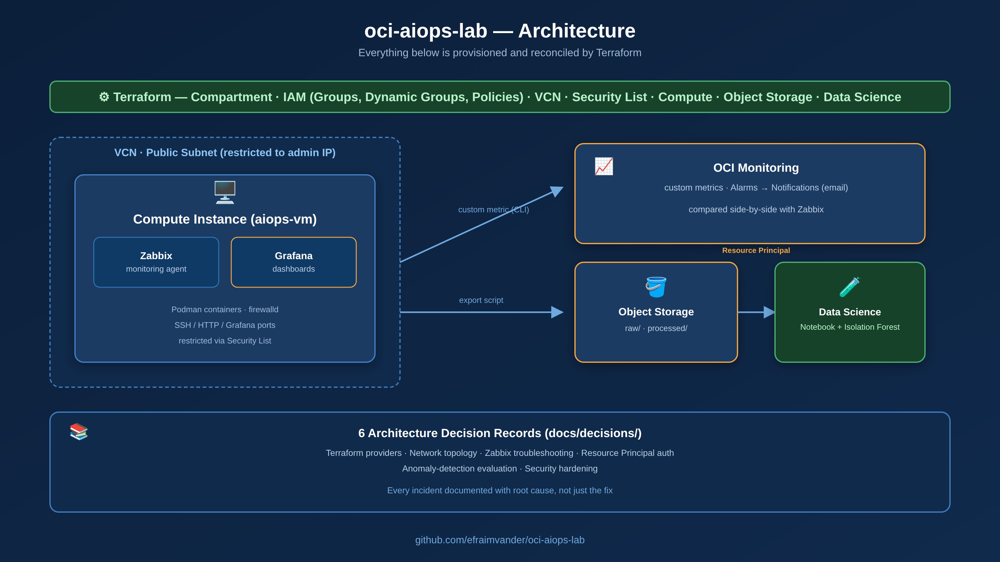

# oci-aiops-lab

**🇬🇧 English** · [🇵🇹 Versão em Português](README.pt.md)

> A hands-on AIOps lab on Oracle Cloud Infrastructure (OCI): infrastructure as code, real-time monitoring, a reproducible data pipeline, and an anomaly-detection model — with every incident documented, not just the happy path.

Built end-to-end with a limited OCI credit budget, as a portfolio project to go deep on cloud infrastructure, Terraform, observability, and applied machine learning.



## What this is

Most "I learned cloud X" portfolio projects show a clean, finished result. This one keeps the scar tissue: **6 Architecture Decision Records (ADRs)** document real incidents hit along the way — a Terraform provider bug, a container that silently stopped responding, an IAM configuration that worked, then mysteriously stopped working, a machine-learning evaluation that looked "too perfect" to be honest — each with its root cause, not just the fix that happened to work.

## Stack

| Layer | Tool |
|---|---|
| Infrastructure as Code | Terraform (`oracle/oci` provider) |
| Identity & Access | OCI IAM — Compartments, Dynamic Groups, Policies, Resource Principal |
| Networking | OCI VCN, public subnet, Security Lists |
| Compute & Monitoring | OCI Compute (Oracle Linux) · Zabbix · OCI Monitoring (custom metrics, Alarms) |
| Dashboards | Grafana (Zabbix data source) |
| Data & ML | OCI Object Storage · OCI Data Science (Notebook Sessions) · scikit-learn (Isolation Forest) |

## Repository structure

```
oci-aiops-lab/
├── docs/
│   ├── decisions/           # 6 ADRs — one per major incident or design decision
│   └── observability.md     # Zabbix vs OCI Monitoring comparison
├── scripts/
│   └── export_zabbix_metrics.py
└── terraform/
    ├── network/              # VCN, subnet, Security List
    ├── compute/              # Zabbix + Grafana host
    ├── storage/              # Object Storage bucket
    ├── datascience/          # Data Science Project + Notebook Session
    └── iam.tf                # Dynamic Group + Policy for Resource Principal
```

## Sessions & decisions

| # | Topic | Key document |
|---|---|---|
| 0-1 | Foundation — Terraform, IAM, networking, compute | [ADR-001](docs/decisions/ADR-001-terraform.md) · [ADR-002](docs/decisions/ADR-002-network-topology.md) |
| 2 | Monitoring — Zabbix install, custom metrics, Alarms | [ADR-003](docs/decisions/ADR-003-zabbix-troubleshooting.md) · [observability.md](docs/observability.md) |
| 3-4 | Data pipeline + anomaly detection (Isolation Forest) | [ADR-004](docs/decisions/ADR-004-resource-principal-auth.md) · [ADR-005](docs/decisions/ADR-005-anomaly-detection-contamination.md) |
| 5 | Grafana dashboard | — |
| 6 | Security hardening | [ADR-006](docs/decisions/ADR-006-hardening-security.md) |

## Result: the anomaly-detection model

Trained an Isolation Forest on real CPU-utilization data (collected via a synthetic `stress-ng` load test), evaluated **without** leaking the ground-truth label into the model's hyperparameters:

| Metric | Value |
|---|---|
| Precision | 0.60 |
| Recall | 1.00 |
| F1 | 0.75 |

Why this isn't 1.00/1.00: see [ADR-005](docs/decisions/ADR-005-anomaly-detection-contamination.md) — a perfect score the first time around was the signal that the evaluation was flawed, not that the model was good.

## Reproducing this

1. Clone the repo and copy `terraform/terraform.tfvars.example` to `terraform/terraform.tfvars`, filling in your own OCI tenancy OCID, user OCID, fingerprint, and key path.
2. `cd terraform && terraform init && terraform plan`
3. Review the plan, then `terraform apply`.

Security note: the default Security List in this repo restricts SSH/Zabbix/Grafana to a single admin CIDR (see [ADR-006](docs/decisions/ADR-006-hardening-security.md)) — set `ssh_allowed_cidr` to your own IP before applying.

## Author

**Efraim Emanuel Vander** — System Administrator, Omnidata (Luanda, Angola)
[LinkedIn](https://www.linkedin.com/) · built and documented session by session, errors included.
