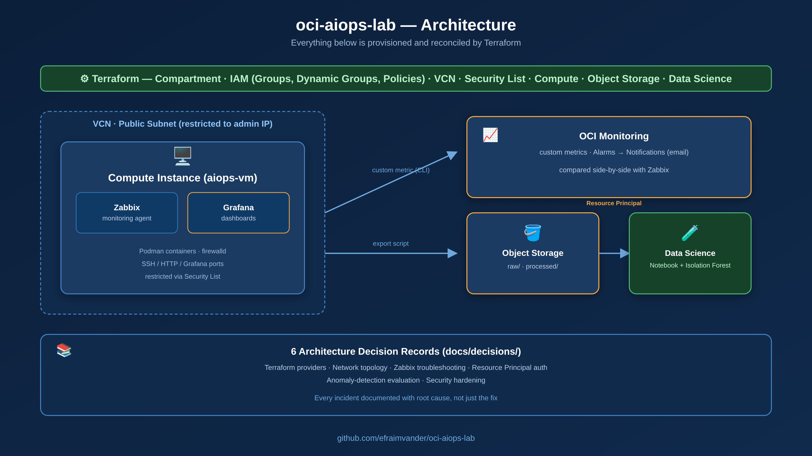

# oci-aiops-lab

[🇬🇧 English version](README.md) · **🇵🇹 Português**

> Um laboratório prático de AIOps na Oracle Cloud Infrastructure (OCI): infra-estrutura como código, monitorização em tempo real, um pipeline de dados reproduzível, e um modelo de detecção de anomalias — com cada incidente documentado, não só o caminho de sucesso.

Construído de ponta a ponta com um orçamento limitado de crédito OCI, como projecto de portefólio para aprofundar infra-estrutura cloud, Terraform, observabilidade e machine learning aplicado.



## O que é isto

A maioria dos projectos de portefólio "aprendi X na cloud" mostra só o resultado final, limpo. Este mantém as cicatrizes: **6 Architecture Decision Records (ADRs)** documentam incidentes reais pelo caminho — um bug no provider do Terraform, um container que deixou de responder silenciosamente, uma configuração de IAM que funcionava e depois parou misteriosamente, uma avaliação de machine learning "boa demais para ser verdade" — cada um com a sua causa raiz, não só a correcção que por acaso funcionou.

## Stack

| Camada | Ferramenta |
|---|---|
| Infra-estrutura como código | Terraform (provider `oracle/oci`) |
| Identidade e Acesso | OCI IAM — Compartments, Dynamic Groups, Policies, Resource Principal |
| Rede | OCI VCN, subnet pública, Security Lists |
| Compute e Monitorização | OCI Compute (Oracle Linux) · Zabbix · OCI Monitoring (métricas customizadas, Alarms) |
| Dashboards | Grafana (data source Zabbix) |
| Dados e ML | OCI Object Storage · OCI Data Science (Notebook Sessions) · scikit-learn (Isolation Forest) |

## Estrutura do repositório

```
oci-aiops-lab/
├── docs/
│   ├── decisions/           # 6 ADRs — um por incidente ou decisao de design
│   └── observability.md     # comparacao Zabbix vs OCI Monitoring
├── scripts/
│   └── export_zabbix_metrics.py
└── terraform/
    ├── network/              # VCN, subnet, Security List
    ├── compute/              # VM com Zabbix + Grafana
    ├── storage/              # bucket Object Storage
    ├── datascience/          # Data Science Project + Notebook Session
    └── iam.tf                # Dynamic Group + Policy para Resource Principal
```

## Sessões e decisões

| # | Tema | Documento principal |
|---|---|---|
| 0-1 | Fundação — Terraform, IAM, rede, compute | [ADR-001](docs/decisions/ADR-001-terraform.md) · [ADR-002](docs/decisions/ADR-002-network-topology.md) |
| 2 | Monitorização — instalação do Zabbix, métricas customizadas, Alarms | [ADR-003](docs/decisions/ADR-003-zabbix-troubleshooting.md) · [observability.md](docs/observability.md) |
| 3-4 | Pipeline de dados + detecção de anomalias (Isolation Forest) | [ADR-004](docs/decisions/ADR-004-resource-principal-auth.md) · [ADR-005](docs/decisions/ADR-005-anomaly-detection-contamination.md) |
| 5 | Dashboard em Grafana | — |
| 6 | Hardening de segurança | [ADR-006](docs/decisions/ADR-006-hardening-security.md) |

## Resultado: o modelo de detecção de anomalias

Treinado um Isolation Forest sobre dados reais de utilização de CPU (recolhidos com um teste de carga sintética via `stress-ng`), avaliado **sem** deixar o rótulo de verdade (ground truth) influenciar os hiperparâmetros do modelo:

| Métrica | Valor |
|---|---|
| Precisão | 0.60 |
| Recall | 1.00 |
| F1 | 0.75 |

Porque não é 1.00/1.00: ver [ADR-005](docs/decisions/ADR-005-anomaly-detection-contamination.md) — um resultado perfeito à primeira foi o sinal de que a avaliação estava errada, não de que o modelo era bom.

## Como reproduzir

1. Clona o repositório e copia `terraform/terraform.tfvars.example` para `terraform/terraform.tfvars`, preenchendo o teu próprio OCID da tenancy, OCID do utilizador, fingerprint, e caminho da chave.
2. `cd terraform && terraform init && terraform plan`
3. Revê o plano, depois `terraform apply`.

Nota de segurança: a Security List por omissão deste repositório restringe SSH/Zabbix/Grafana a um único CIDR de administrador (ver [ADR-006](docs/decisions/ADR-006-hardening-security.md)) — define `ssh_allowed_cidr` com o teu próprio IP antes de aplicares.

## Autor

**Efraim Emanuel Vander** — System Administrator, Omnidata (Luanda, Angola)
[LinkedIn](https://www.linkedin.com/) · construído e documentado sessão a sessão, erros incluídos.
